# 👁️ QoriVision - Biometric Oracle Microservice

[](https://www.python.org/)
[](https://fastapi.tiangolo.com/)
[](https://opencv.org/)
[](https://www.docker.com/)
[](LICENSE)

**QoriVision** es un microservicio de **Oráculo Biométrico** de alta velocidad diseñado para sistemas descentralizados de votación electrónica sobre Blockchain. 

Su propósito central es verificar la autenticidad facial de un elector (*Liveness Detection / Anti-Spoofing* y *Face Matching*) sin persistir imágenes biométricas en disco, emitiendo una credencial criptográfica determinista (**Nullifier Seed**) requerida para registrar el voto en el libro mayor distribuido bajo esquemas de Privacidad / Zero-Knowledge (ZKP).

---

## 🏛️ Arquitectura y Rol en Blockchain

En los sistemas de votación basados en contratos inteligentes y protocolos de privacidad (como *Semaphore* o *MACI*), es crítico garantizar dos propiedades opuestas:
1. **Unicidad:** Una persona física = Un único voto.
2. **Anonimato:** El voto emitido no puede vincularse a la identidad del elector.

```mermaid
flowchart LR
    A["Elector (DNI + Foto)"] -->|"POST /api/verify"| B["QoriVision Oracle (FastAPI)"]
    B -->|"Buffer en Memoria"| C["OpenCV Matrix (Sin disco)"]
    C -->|"Inferencia CNN"| D["Liveness & Face Matching"]
    D -->|"Hash Criptográfico (SHA-256)"| E["Nullifier Seed"]
    E -->|"JSON Autorización"| F["Smart Contract / ZK Circuit"]
    F -->|"Voto Válido"| G["Blockchain Ledger"]
```



QoriVision actúa como la **puerta de enlace biométrica fuera de cadena (*off-chain*)**: procesa la prueba visual, valida que el sujeto es real y genera un **Nullifier Seed** que el contrato inteligente utilizará como clave única de nulidad, impidiendo el doble voto sin almacenar datos personales en la cadena.

---

## 🚀 Características Principales

- **Procesamiento 100% en Memoria (Zero-Disk I/O):** Decodificación directa mediante `np.frombuffer` y `cv2.imdecode` para garantizar máxima privacidad y evitar vectores de filtración forense en disco.
- **Microservicio Asíncrono:** Construido con FastAPI y Uvicorn para alto rendimiento y baja latencia en concurrencia.
- **Inferencia CNN Integrada:** Pipeline preparado para modelos convolucionales de Anti-Spoofing (e.g., Silent-Face-Anti-Spoofing) y embeddings faciales (e.g., ArcFace).
- **Despliegue Automatizado:** Script unificado en Bash (`build_qorivision.sh`) que genera el stack completo, compila la imagen Docker y ejecuta pruebas automatizadas en caliente.
- **Contenedor Minimalista:** Imagen basada en `python:3.10-slim` con `opencv-python-headless` para evitar dependencias innecesarias de GUI en producción.

---

## 📂 Estructura del Proyecto

```text
QoriVision/
├── build_qorivision.sh      # Script maestro de compilación, despliegue y test
├── Dockerfile               # Contenedor optimizado Python 3.10-slim
├── main.py                  # Servidor FastAPI y lógica del oráculo biométrico
├── requirements.txt         # Dependencias Python
├── README.md                # Documentación general del servicio
├── EXPLICACION_CODIGO.md    # Explicación técnica detallada del código
├── .gitignore               # Exclusiones para control de versiones
└── LICENSE                  # Licencia MIT
```

---

## ⚡ Inicio Rápido

### Requisitos Previos
- [Docker](https://www.docker.com/) instalado y en ejecución.
- Entorno Bash (Linux, macOS, WSL o Git Bash en Windows).
- `curl` para ejecución de peticiones HTTP.

### Despliegue Automatizado
Basta con ejecutar el script unificado:

```bash
chmod +x build_qorivision.sh
./build_qorivision.sh
```

El script ejecutará las siguientes fases:
1. Generación de `requirements.txt`, `main.py` y `Dockerfile` mediante directivas `cat << 'EOF'`.
2. Construcción de la imagen Docker `qorivision-image`.
3. Detención de contenedores previos y lanzamiento de `qorivision-app` en segundo plano en el puerto `8081`.
4. Tiempo de estabilización de Uvicorn (4 segundos).
5. Creación dinámica de una imagen sintética de prueba (`test_face.jpg`) y envío de solicitud multipart al endpoint `/api/verify`.
6. Impresión del resultado JSON en consola.

---

## 📡 Referencia de la API

### 1. Verificación Biométrica
- **Método:** `POST`
- **Ruta:** `/api/verify`
- **Content-Type:** `multipart/form-data`

#### Parámetros
| Parámetro | Tipo | Ubicación | Descripción |
|---|---|---|---|
| `dni` | `string` | Form Data | Documento de Identidad del elector. |
| `file` | `file` | Form Data | Imagen del rostro del elector (JPEG / PNG). |

#### Ejemplo de Petición con cURL
```bash
curl -X POST "http://localhost:8081/api/verify" \
  -F "dni=76543210" \
  -F "file=@test_face.jpg"
```

#### Respuesta Exitosa (`200 OK`)
```json
{
  "status": "verified",
  "confidence": 99.8,
  "nullifier_seed": "5ab9eaba099bfa5d38c43124f98dd6d26ece93d776770d268c257ec2399b4747",
  "execution_time_ms": 501.75
}
```

### 2. Comprobación de Salud (Health Check)
- **Método:** `GET`
- **Ruta:** `/health`
- **Respuesta (`200 OK`):**
  ```json
  {
    "status": "ok",
    "service": "QoriVision"
  }
  ```

---

## 📖 Documentación Técnica

Para un análisis exhaustivo línea por línea de la implementación, arquitectura de software, manejo de buffers y consideraciones de seguridad, consulta [EXPLICACION_CODIGO.md](EXPLICACION_CODIGO.md).

---

## 📄 Licencia

Este proyecto está bajo la Licencia MIT. Consulta el archivo [LICENSE](LICENSE) para más información.
